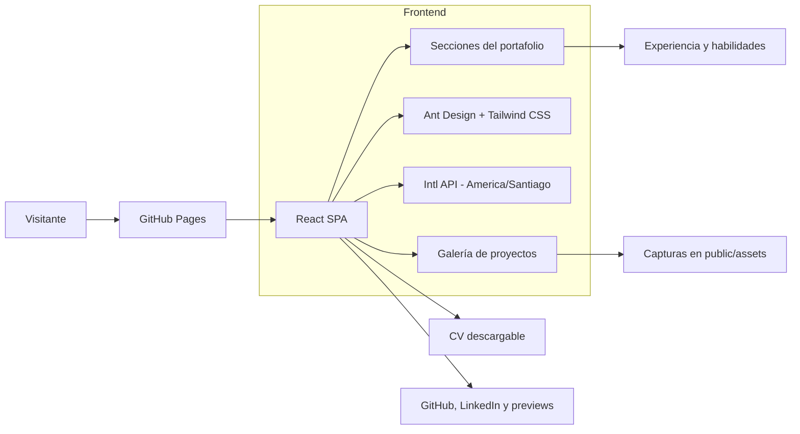
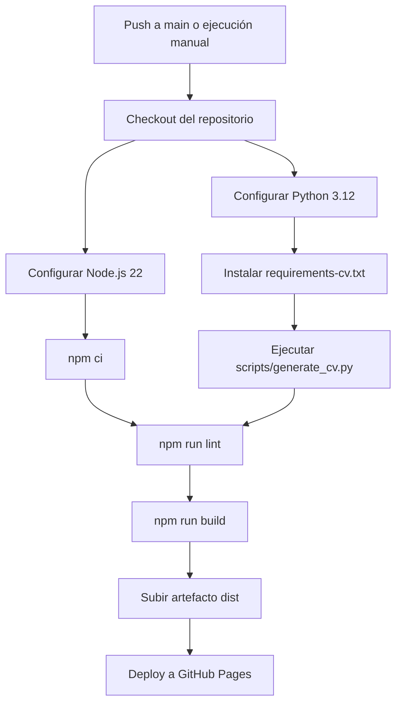

# Portafolio Full Stack - Luis Valenzuela

[](https://react.dev/)
[](https://vite.dev/)
[](https://tailwindcss.com/)
[](https://ant.design/)
[](https://lushooc.github.io/)

Portafolio profesional de **Luis Valenzuela Madrid**, Ingeniero en Informática y Full Stack Developer. El proyecto presenta experiencia profesional, stack tecnológico, proyectos seleccionados y un CV generado automáticamente como parte del proceso de despliegue.

**Producción:** [lushooc.github.io](https://lushooc.github.io/)

## Características principales

- SPA responsiva construida con React y Vite.
- Sistema visual personalizado con Tailwind CSS, CSS moderno y componentes de Ant Design.
- Animaciones de entrada mediante `IntersectionObserver` y soporte para `prefers-reduced-motion`.
- Experiencia profesional con fechas calculadas usando la zona horaria `America/Santiago`.
- Carrusel tecnológico con herramientas de frontend, backend, automatización, cloud e IA.
- Galería de proyectos con capturas, etiquetas, modales y enlaces externos.
- CV de una página, compatible con ATS y regenerado antes de cada despliegue.
- Publicación automatizada en GitHub Pages mediante GitHub Actions.

## Arquitectura



La aplicación mantiene el contenido principal en estructuras de datos dentro de React. Las fechas del cargo actual se calculan en el navegador, evitando valores de antigüedad hardcodeados y respetando el calendario de Chile.

## Pipeline de despliegue



El PDF no se genera al momento de hacer clic. GitHub Pages sirve archivos estáticos, por lo que el pipeline crea la versión vigente del CV antes de construir y publicar el sitio.

## Stack tecnológico

| Área | Tecnologías |
| --- | --- |
| Frontend | React 19, JavaScript, Tailwind CSS 4, CSS3 |
| UI | Ant Design 6, Ant Design Icons, React Icons |
| Build | Vite 8 |
| Calidad | ESLint 10 |
| CV | Python 3.12, ReportLab |
| CI/CD | GitHub Actions, GitHub Pages |

## Estructura del proyecto

```text
Lushooc.github.io/
|-- .github/workflows/
|   `-- deploy.yml              # Pipeline de build y despliegue
|-- public/
|   |-- assets/                 # Fotografías y capturas de proyectos
|   `-- documents/
|       `-- cv-luis-valenzuela.pdf
|-- scripts/
|   `-- generate_cv.py          # Fuente reproducible del CV
|-- src/
|   |-- App.jsx                 # Contenido y componentes principales
|   |-- index.css               # Sistema visual y diseño responsivo
|   `-- main.jsx                # Entrada de React
|-- requirements-cv.txt         # Dependencias del generador PDF
|-- package.json
`-- vite.config.js
```

## Desarrollo local

### Requisitos

- Node.js 22 o compatible.
- npm.
- Python 3.12 para regenerar el CV.

### Instalación

```bash
git clone https://github.com/Lushooc/Lushooc.github.io.git
cd Lushooc.github.io
npm ci
python -m pip install -r requirements-cv.txt
```

### Servidor de desarrollo

```bash
npm run dev
```

Vite mostrará la dirección local, normalmente `http://localhost:5173/`.

## Generación del CV

```bash
python scripts/generate_cv.py
```

El generador produce dos copias idénticas:

- `output/pdf/cv-luis-valenzuela.pdf`: artefacto local de salida.
- `public/documents/cv-luis-valenzuela.pdf`: archivo incluido por Vite y descargado desde el portafolio.

La experiencia vigente utiliza el formato `Abr 2025 - Actualidad`. Los cambios de cargo, responsabilidades o tecnologías deben realizarse en el generador y publicarse mediante un nuevo push.

## Verificación

```bash
npm run lint
npm run build
```

El build de producción se escribe en `dist/`. Tanto `dist/` como los artefactos temporales están excluidos del control de versiones.

## Publicación

El workflow [deploy.yml](.github/workflows/deploy.yml) se ejecuta automáticamente con cada push a `main` y también puede iniciarse manualmente desde **Actions**. En **Settings > Pages**, la fuente de publicación debe estar configurada como **GitHub Actions**.

## Contacto

- [LinkedIn](https://www.linkedin.com/in/luis-valenzuelam/)
- [GitHub](https://github.com/Lushooc)
- [Portafolio](https://lushooc.github.io/)
